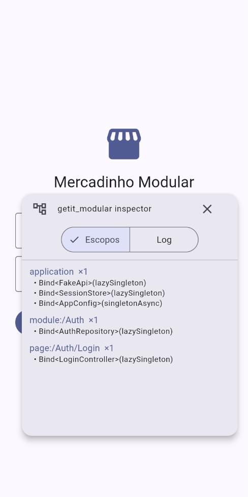

<div align="right">
  <a href="https://pub.dev/packages/getit_modular"></a>
  <br/>
  
  <br/>
  
  <br/>
  <a href="LICENSE"></a>
  <br/>
  
</div>

<br clear="both"/>

# getit_modular

**Injeção de dependências para Flutter com módulos que sobem quando você precisa e se descartam sozinhos quando você sai.**

`getit_modular` junta duas ideias:

1. **Um service locator com a API do [get_it](https://github.com/flutter-it/get_it)**, reimplementado dentro do package (sem depender dele): factories, singletons, lazy, async, parâmetros, escopos, `allReady`/`signalReady`, `dependsOn`, dispose e shadowing.
2. **Uma camada modular inspirada no [flutter_getit](https://github.com/rodrigorahman/getit_flutter)**: você organiza o app em **módulos**, **sub-módulos** e **páginas**, e cada um declara seus `Bind`s. As dependências são registradas **só quando a rota é aberta** e **descartadas automaticamente** (com `dispose`) quando você sai da rota ou do módulo.

```dart
class ProductsModule extends GetItModule {
  @override
  String get moduleRouteName => '/Products';

  @override
  List<Bind> get bindings => [Bind.lazySingleton((i) => ProductsRepository(i()))];

  @override
  List<GetItRouter> get pages => [
        GetItPageRouter(
          name: '/',
          bindings: [Bind.lazySingleton((i) => ProductsController(i()))],
          builder: (_) => const ProductsPage(),
        ),
      ];
}
// Entrou em /Products   -> ProductsRepository e ProductsController registrados
// Saiu do módulo        -> onDispose() chamado e tudo removido do GetIt
```

## Por que getit_modular?

- **🧩 Modular de verdade**: cada feature declara as próprias dependências, rotas e middlewares.
- **♻️ Dispose automático**: ao sair da rota ou do módulo, os binds são removidos e `onDispose` é chamado. Sem vazamento de controllers.
- **⏱️ Sob demanda**: nada é instanciado antes de a rota abrir; com `lazySingleton`, nem antes do primeiro uso.
- **🔢 Contagem de referências**: um módulo continua vivo enquanto qualquer rota dele estiver na pilha, e um bind compartilhado só sai quando o último escopo que o usa fecha.
- **⚡ Assíncrono de primeira**: `singletonAsync`, `dependsOn`, `builderAsync`, middlewares assíncronos com loader e splash via `isReady`.
- **🛡️ Middlewares**: guards de autenticação e verificações antes de abrir a rota.
- **🧪 Testável**: mocks registrados antes no `GetIt` são reaproveitados pela camada modular, e o núcleo tem `GetIt.asNewInstance()` e `reset()`.
- **🔍 Observável**: log do ciclo de vida e um `ChangeNotifier` com os escopos abertos, para montar inspectors como o do exemplo.

<p align="center">
  
  
  
</p>
<p align="center"><sub>App de exemplo: o inspector mostra os escopos abertos e o log de registro e dispose em tempo real.</sub></p>

---

## Sumário

- [Instalação](#instalação)
- [Início rápido](#início-rápido)
- [Como funciona: escopos e ciclo de vida](#como-funciona-escopos-e-ciclo-de-vida)
- [GetItModular (widget raiz)](#getitmodular-widget-raiz)
- [Módulos e rotas](#módulos-e-rotas)
- [Bind: tipos de registro](#bind-tipos-de-registro)
- [Recuperando instâncias](#recuperando-instâncias)
- [Ciclo de vida das instâncias (ModularLifecycle)](#ciclo-de-vida-das-instâncias-modularlifecycle)
- [Páginas assíncronas](#páginas-assíncronas)
- [Middlewares](#middlewares)
- [Widgets auxiliares](#widgets-auxiliares)
- [Debug: log e inspector](#debug-log-e-inspector)
- [Testes](#testes)
- [Núcleo GetIt (API do get_it)](#núcleo-getit-api-do-get_it)
- [Vindo do flutter_getit?](#vindo-do-flutter_getit)
- [Limitações](#limitações)
- [App de exemplo](#app-de-exemplo)

---

## Instalação

Adicione o package pelo terminal:

```bash
flutter pub add getit_modular
```

Ou declare no `pubspec.yaml` e rode `flutter pub get`:

```yaml
dependencies:
  getit_modular: ^0.1.0
```

Depois importe:

```dart
import 'package:getit_modular/getit_modular.dart';
```

Esse import expõe tudo: o núcleo `GetIt` e a camada modular.

---

## Início rápido

Um app completo com dependências globais, dois módulos e navegação entre eles:

```dart
import 'package:flutter/material.dart';
import 'package:getit_modular/getit_modular.dart';

void main() => runApp(const App());

// 1. Dependências que vivem o app inteiro
class AppBindings extends ApplicationBindings {
  @override
  List<Bind> bindings() => [
        Bind.lazySingleton<ApiClient>((i) => ApiClient()),
      ];
}

// 2. Um módulo por feature
class AuthModule extends GetItModule {
  @override
  String get moduleRouteName => '/Auth';

  @override
  List<Bind> get bindings => [
        Bind.lazySingleton<AuthRepository>((i) => AuthRepository(i<ApiClient>())),
      ];

  @override
  List<GetItRouter> get pages => [
        GetItPageRouter(
          name: '/Login',                                    // rota: /Auth/Login
          bindings: [
            Bind.lazySingleton<LoginController>((i) => LoginController(i())),
          ],
          builder: (context) => LoginPage(controller: context.get()),
        ),
      ];
}

class HomeModule extends GetItModule {
  @override
  String get moduleRouteName => '/Home';

  @override
  List<GetItRouter> get pages => [
        GetItPageRouter(
          name: '/',                                         // rota: /Home
          bindings: [Bind.lazySingleton((i) => HomeController())],
          builder: (_) => const HomePage(),
        ),
      ];
}

// 3. Widget raiz
class App extends StatelessWidget {
  const App({super.key});

  @override
  Widget build(BuildContext context) {
    return GetItModular(
      bindings: AppBindings(),
      modules: [AuthModule(), HomeModule()],
      builder: (context, routes, isReady) => MaterialApp(
        initialRoute: '/Auth/Login',
        routes: routes,
      ),
    );
  }
}
```

Ao fazer login e chamar `Navigator.pushNamedAndRemoveUntil('/Home', (_) => false)`, o módulo `/Auth` inteiro (`AuthRepository` e `LoginController`) é descartado e os binds de `/Home` são registrados.

---

## Como funciona: escopos e ciclo de vida

Cada rota resolvida conhece a **cadeia de escopos** que precisa abrir:

```
/Auth/Register/Password

application ─► module:/Auth ─► module:/Auth/Register ─► page:/Auth/Register/Password
 (sempre)      (GetItModule)   (GetItModuleRouter)       (GetItPageRouter)
```

| Momento | O que acontece |
|---|---|
| A rota é construída | Cada escopo da cadeia é aberto. Se é a **primeira** referência, os binds dele são registrados no `GetIt` e o `onInit` do módulo roda. |
| Navegação dentro do mesmo módulo | O escopo do módulo só ganha mais uma referência. Nada é recriado. |
| A rota sai da pilha (`pop`, `pushReplacement`, `pushNamedAndRemoveUntil`…) | Cada escopo perde uma referência. O escopo que chega a **zero** roda o `onDispose` e remove seus binds do `GetIt`, chamando o dispose das instâncias. |
| Bind declarado em dois escopos abertos | Fica registrado até o último dos dois fechar. |
| `keepAlive: true` | Nunca é removido. |
| Tipo já registrado no `GetIt` por fora do modular | É reaproveitado e nunca removido pelo modular (útil para mocks). |

Isso usa o ciclo de vida normal do Flutter (`initState`/`dispose` da rota). Não há navegação própria: continue usando `Navigator.pushNamed` e os demais métodos.

### Nomes de rota

O caminho final é a concatenação dos `name`s:

| Declaração | Rota |
|---|---|
| `moduleRouteName: '/Auth'` + `GetItPageRouter(name: '/Login')` | `/Auth/Login` |
| `'/Auth'` + `GetItModuleRouter(name: '/Register')` + `GetItPageRouter(name: '/')` | `/Auth/Register` |
| `'/Auth'` + `'/Register'` + `GetItPageRouter(name: '/Password')` | `/Auth/Register/Password` |
| `GetItModular(pages: [GetItPageRouter(name: '/About')])` | `/About` |

`name: '/'` (ou `''`) representa a rota "índice" do grupo. Rotas duplicadas lançam erro na inicialização.

---

## GetItModular (widget raiz)

```dart
GetItModular(
  bindings: AppBindings(),                  // dependências globais
  modules: [AuthModule(), HomeModule()],    // módulos em classe
  pages: [                                  // rotas avulsas / grupos inline
    GetItPageRouter(name: '/About', builder: (_) => const AboutPage()),
  ],
  middlewares: [const LogMiddleware()],     // rodam em todas as rotas
  logEnabled: kDebugMode,                   // log do ciclo de vida
  getIt: GetIt.I,                           // instância do container (padrão)
  builder: (context, routes, isReady) => MaterialApp(
    initialRoute: '/Auth/Login',
    routes: routes,
    // Splash enquanto os binds assíncronos da aplicação carregam
    builder: (context, child) => isReady ? child! : const SplashPage(),
  ),
);
```

| Parâmetro | Descrição |
|---|---|
| `builder` | `(context, routes, isReady)`. Entregue `routes` ao `MaterialApp.routes` (ou `CupertinoApp`). |
| `bindings` | `ApplicationBindings` com os binds que vivem o app inteiro. |
| `modules` | Lista de `GetItModule`. |
| `pages` | `GetItPageRouter`s e `GetItModuleRouter`s sem classe de módulo. |
| `middlewares` | Middlewares globais, executados antes dos de módulo e página. |
| `getIt` | Instância do `GetIt` usada. Padrão: `GetIt.I`. |
| `logEnabled` | Liga o `ModularLogger`. |

O `isReady` vira `true` quando todos os binds assíncronos da aplicação (por exemplo `Bind.singletonAsync`) terminam.

### onGenerateRoute

Se preferir `onGenerateRoute` ao mapa `routes`:

```dart
MaterialApp(
  initialRoute: '/Auth/Login',
  onGenerateRoute: GetItModular.onGenerateRoute,
)
```

### ApplicationBindings

```dart
class AppBindings extends ApplicationBindings {
  @override
  List<Bind> bindings() => [
        Bind.lazySingleton<Dio>((i) => Dio(BaseOptions(baseUrl: Env.api))),
        Bind.lazySingleton<SessionStore>((i) => SessionStore()),
        Bind.singletonAsync<SharedPreferences>((i) => SharedPreferences.getInstance()),
      ];
}
```

---

## Módulos e rotas

Existem três blocos de construção:

| Classe | Papel |
|---|---|
| `GetItModule` | Módulo em classe: prefixo de rota, binds compartilhados, `onInit`/`onDispose` e middlewares. |
| `GetItModuleRouter` | Grupo (sub-módulo) declarado inline. Pode conter páginas e outros grupos, com quantos níveis quiser. |
| `GetItPageRouter` | Página: `builder` ou `builderAsync`, com binds e middlewares próprios. |

### GetItModule

```dart
class AuthModule extends GetItModule {
  @override
  String get moduleRouteName => '/Auth';

  /// Compartilhados por todas as rotas do módulo.
  @override
  List<Bind> get bindings => [
        Bind.lazySingleton<AuthRepository>((i) => AuthRepository(i(), i())),
      ];

  @override
  List<GetItMiddleware> get middlewares => const [];

  /// Primeira entrada em qualquer rota do módulo.
  @override
  void onInit(Injector i) => analytics.log('auth_started');

  /// Última rota do módulo fechada (antes de os binds serem removidos).
  @override
  void onDispose(Injector i) => analytics.log('auth_finished');

  @override
  List<GetItRouter> get pages => [
        GetItPageRouter(
          name: '/Login',
          bindings: [Bind.lazySingleton((i) => LoginController(i()))],
          builder: (_) => const LoginPage(),
        ),

        // Sub-módulo: o RegisterController é compartilhado pelas duas etapas
        // e descartado quando o usuário sai do cadastro.
        GetItModuleRouter(
          name: '/Register',
          bindings: [Bind.lazySingleton((i) => RegisterController(i()))],
          onInit: (i) => debugPrint('cadastro iniciado'),
          onDispose: (i) => debugPrint('cadastro encerrado'),
          pages: [
            GetItPageRouter(name: '/', builder: (_) => const RegisterNamePage()),
            GetItPageRouter(name: '/Password', builder: (_) => const RegisterPasswordPage()),
          ],
        ),
      ];
}
```

### GetItPageRouter

| Parâmetro | Descrição |
|---|---|
| `name` | Segmento da rota (`/Login`, ou `/` para a rota índice). |
| `builder` | `WidgetBuilder` da página. |
| `builderAsync` | `(context, isReady, loader)`. Use quando houver binds ou middlewares assíncronos. |
| `bindings` | Binds com o tempo de vida da página. |
| `middlewares` | Middlewares só desta página. |

### GetItModuleRouter

| Parâmetro | Descrição |
|---|---|
| `name` | Prefixo do grupo. |
| `pages` | `GetItPageRouter`s e/ou `GetItModuleRouter`s filhos. |
| `bindings` | Binds compartilhados pelo grupo. |
| `middlewares` | Middlewares do grupo. |
| `onInit` / `onDispose` | Entrada e saída do grupo. |

### Rotas sem classe de módulo

```dart
GetItModular(
  pages: [
    GetItPageRouter(name: '/Splash', builder: (_) => const SplashPage()),
    GetItModuleRouter(
      name: '/Settings',
      bindings: [Bind.lazySingleton((i) => SettingsController())],
      pages: [
        GetItPageRouter(name: '/', builder: (_) => const SettingsPage()),
        GetItPageRouter(name: '/Theme', builder: (_) => const ThemePage()),
      ],
    ),
  ],
  builder: ...,
);
```

---

## Bind: tipos de registro

| Bind | Quando cria | Observações |
|---|---|---|
| `Bind.singleton` | Ao abrir o escopo | Aceita `dependsOn` para esperar binds assíncronos. |
| `Bind.singletonAsync` | Ao abrir o escopo, de forma assíncrona | A página espera via `builderAsync` e o app via `isReady`. |
| `Bind.lazySingleton` | No primeiro `get` | Mesma instância até o escopo fechar. |
| `Bind.lazySingletonAsync` | No primeiro `getAsync` | |
| `Bind.factory` | A cada `get` | Instâncias com dispose são descartadas quando o escopo fecha. |
| `Bind.factoryAsync` | A cada `getAsync` | |
| `Bind.factoryParam<T, P1, P2>` | A cada `get(param1:, param2:)` | Factory com parâmetros. |

Parâmetros comuns:

| Parâmetro | Descrição |
|---|---|
| `tag` | Nome do registro (o `instanceName` do get_it), para ter várias instâncias do mesmo tipo. |
| `keepAlive` | (singletons) Não remove a instância ao sair do escopo. |
| `dependsOn` | (`singleton`/`singletonAsync`) Tipos que precisam estar prontos antes. |
| `onDispose` | Função de dispose customizada. Sem ela, usa `Disposable`/`ModularLifecycle`. |

```dart
bindings: [
  // Dependências recebidas pelo Injector `i`
  Bind.lazySingleton<ProductsRepository>((i) => ProductsRepository(i<ApiClient>())),

  // Atalho: i() infere o tipo pelo parâmetro do construtor
  Bind.lazySingleton((i) => ProductsController(i(), i())),

  // Assíncrono
  Bind.singletonAsync<Database>((i) => Database.open()),

  // Só cria depois que Database estiver pronto
  Bind.singleton<UserDao>((i) => UserDao(i()), dependsOn: [Database]),

  // Várias instâncias do mesmo tipo
  Bind.lazySingleton<Dio>((i) => Dio(), tag: 'public'),
  Bind.lazySingleton<Dio>((i) => Dio()..interceptors.add(Auth()), tag: 'auth'),

  // Factory com parâmetros
  Bind.factoryParam<PriceLabel, double, String?>(
    (i, value, currency) => PriceLabel(value, currency: currency ?? r'R$'),
  ),

  // Sobrevive à saída do módulo
  Bind.lazySingleton<RecentlyViewed>((i) => RecentlyViewed(), keepAlive: true),

  // Dispose customizado
  Bind.lazySingleton<StreamController<int>>(
    (i) => StreamController.broadcast(),
    onDispose: (c) => c.close(),
  ),
]
```

---

## Recuperando instâncias

```dart
// Em widgets
final controller = context.get<HomeController>();
final dio = context.get<Dio>(tag: 'auth');
final label = context.get<PriceLabel>(param1: 10.5);
final db = await context.getAsync<Database>();
context.isRegistered<HomeController>();

// Em qualquer lugar
Injector.I.get<SessionStore>();
Injector.I<SessionStore>();          // call()
Injector.I.maybeGet<Analytics>();    // null se não registrado

// Dentro dos binds, o Injector chega como parâmetro
Bind.lazySingleton((i) => Repo(i(), i.get(tag: 'auth')));

// Direto no núcleo
GetIt.I<SessionStore>();
```

### Argumentos de rota

```dart
Navigator.of(context).pushNamed('/Products/Detail', arguments: product.id);

// No bind (argumentos da rota modular que está abrindo):
Bind.lazySingleton((i) => ProductDetailController(id: i.arguments! as int, repo: i()));

// No widget (argumentos da rota atual):
final id = context.arguments<int>();
```

### GetItView

Um `StatelessWidget` com um getter tipado:

```dart
class LoginPage extends GetItView<LoginController> {
  const LoginPage({super.key});

  @override
  Widget build(BuildContext context) => Text(controller.title);
}
```

---

## Ciclo de vida das instâncias (ModularLifecycle)

```dart
class HomeController extends ChangeNotifier with ModularLifecycle {
  late final StreamSubscription _sub;

  @override
  void onInit() {
    // Logo após a criação pelo Bind
    _sub = events.listen(_onEvent);
  }

  @override
  void onDispose() {
    // Ao sair da rota/módulo dono do bind
    _sub.cancel();
    dispose(); // ChangeNotifier.dispose
  }
}
```

O dispose também é automático para:

- classes que implementam `Disposable` (`onDispose`);
- binds com o callback `onDispose:`;
- instâncias criadas por `factory`/`factoryAsync`/`factoryParam` que tenham dispose. Elas são guardadas e descartadas quando o escopo fecha.

---

## Páginas assíncronas

Use `builderAsync` quando a página depender de binds assíncronos ou de middlewares assíncronos:

```dart
GetItPageRouter(
  name: '/',
  bindings: [
    Bind.singletonAsync<ProductsController>(
      (i) async => ProductsController(await i<ProductsRepository>().fetchAll()),
    ),
  ],
  builderAsync: (context, isReady, loader) => isReady
      ? const ProductsPage()
      : Scaffold(body: loader ?? const Center(child: CircularProgressIndicator())),
)
```

- `isReady`: os middlewares passaram e todos os binds assíncronos estão prontos.
- `loader`: o widget do middleware assíncrono em execução, ou `null`.

---

## Middlewares

Middlewares rodam quando a rota abre, **na ordem**: globais → módulo → sub-módulos → página.

```dart
/// Síncrono: guard de autenticação
class AuthGuard extends GetItSyncMiddleware {
  const AuthGuard();

  @override
  MiddlewareResult execute(RouteSettings? route) =>
      Injector.I.get<SessionStore>().isLogged
          ? MiddlewareResult.next
          : MiddlewareResult.failure;

  /// Padrão: pop() se possível.
  @override
  void onFail(RouteSettings? route, MiddlewareContext context, MiddlewareResult result) {
    context.pushNamedAndRemoveUntil('/Auth/Login', (_) => false);
  }
}

/// Assíncrono: o loader aparece no builderAsync enquanto executa
class CatalogPermissionMiddleware extends GetItAsyncMiddleware {
  const CatalogPermissionMiddleware();

  /// Só roda na lista, não no detalhe
  @override
  bool executeWhen(RouteSettings? route) => route?.name == '/Products';

  @override
  Future<MiddlewareResult> execute(RouteSettings? route) async =>
      await Injector.I<Api>().canSeeCatalog()
          ? MiddlewareResult.next
          : MiddlewareResult.failure;

  @override
  Widget get loader => const Center(child: Text('Verificando permissões...'));
}

class HomeModule extends GetItModule {
  @override
  List<GetItMiddleware> get middlewares => const [AuthGuard()];
  // ...
}
```

| Resultado | Efeito |
|---|---|
| `MiddlewareResult.next` | Segue para o próximo middleware. |
| `MiddlewareResult.complete` | Encerra a cadeia com sucesso; os próximos não rodam. |
| `MiddlewareResult.failure` | Interrompe e chama `onFail`. A página não fica `ready`. |

O `MiddlewareContext` oferece `pop`, `canPop`, `pushReplacementNamed`, `pushNamedAndRemoveUntil`, `showSnackBar`, `navigator` e `context`.

---

## Widgets auxiliares

### GetItModularWidget

Binds com o tempo de vida de **um widget** (aba, card, dialog):

```dart
GetItModularWidget(
  name: 'profile',          // opcional; widgets com o mesmo nome compartilham o escopo
  binds: [Bind.lazySingleton((i) => ProfileController(i()))],
  onInit: (i) {},
  onDispose: (i) {},
  builder: (context) => ProfileView(controller: context.get()),
)
```

### GetItRouteOutlet

Um `Navigator` aninhado que resolve as rotas modulares. Serve para abas que mantêm a própria pilha:

```dart
Scaffold(
  body: GetItRouteOutlet(
    navigatorKey: _productsNavigator,
    initialRoute: '/Products',          // lista -> detalhe dentro da aba
  ),
  bottomNavigationBar: NavigationBar(...),
)
```

Para sair do navigator aninhado, use `Navigator.of(context, rootNavigator: true)`.

---

## Debug: log e inspector

```dart
GetItModular(logEnabled: true, ...);

// Redirecionar a saída do log (ex.: para uma tela de debug)
ModularLogger.output = (message) => myLogs.add(message);
```

```
[getit_modular] 🚪 enter module:/Products/Detail
[getit_modular] ➕ register Bind<ProductDetailController>(lazySingleton)
[getit_modular] 👋 exit module:/Products/Detail
[getit_modular] 🗑️ dispose Bind<ProductDetailController>(lazySingleton)
```

O `ModularContainer` é um `ChangeNotifier`, então dá para observar os escopos abertos:

```dart
final container = ModularContainer.instance;
container.addListener(() {
  for (final scope in container.scopes) {
    print('${scope.id} ×${scope.references}: ${scope.binds}');
  }
});
```

O app de exemplo usa isso no `ScopeInspector` ([`example/lib/core/widgets/scope_inspector.dart`](example/lib/core/widgets/scope_inspector.dart)).

---

## Testes

### Mockando dependências

Tipos registrados no `GetIt` **antes** do `GetItModular` são reaproveitados pelos binds e nunca removidos pelo modular:

```dart
testWidgets('lista produtos', (tester) async {
  GetIt.I.registerSingleton<ProductsRepository>(FakeProductsRepository());

  await tester.pumpWidget(const App());
  // ... ProductsModule usa o FakeProductsRepository
});

tearDown(() => GetIt.I.reset());
```

### Verificando o ciclo de vida

```dart
await tester.tap(find.text('Entrar'));
await tester.pumpAndSettle();

expect(GetIt.I.isRegistered<LoginController>(), isFalse);  // descartado
expect(GetIt.I.isRegistered<HomeController>(), isTrue);    // registrado
expect(ModularContainer.instance.openScopes.keys,
    ['application', 'module:/Home', 'page:/Home']);
```

### Testando o núcleo isolado

```dart
final getIt = GetIt.asNewInstance();
getIt.registerLazySingleton<Repo>(() => FakeRepo());
expect(getIt<Repo>(), isA<FakeRepo>());
```

---

## Núcleo GetIt (API do get_it)

O núcleo pode ser usado sozinho, igual ao `get_it`:

```dart
final getIt = GetIt.instance; // ou GetIt.I
```

### Registro

```dart
// Factory: nova instância a cada chamada
getIt.registerFactory<Validator>(() => Validator());

// Singleton: instância já criada
getIt.registerSingleton<Api>(ApiImpl());

// Lazy singleton: criado no primeiro uso
getIt.registerLazySingleton<Repo>(() => Repo(getIt()));

// Com nome
getIt.registerSingleton<Dio>(Dio(), instanceName: 'auth');
getIt<Dio>(instanceName: 'auth');

// Factory com parâmetros
getIt.registerFactoryParam<Greeting, String, int?>((name, times) => Greeting(name, times));
getIt<Greeting>(param1: 'Ana', param2: 2);

// Factory com cache (reaproveita enquanto a instância estiver viva e os params forem iguais)
getIt.registerCachedFactory<Heavy>(() => Heavy());
getIt.registerCachedFactoryParam<Page, int, void>((n, _) => Page(n));

// Lazy com referência fraca (recriado se for coletado pelo GC)
getIt.registerLazySingleton<Cache>(() => Cache(), useWeakReference: true);

// Callback de criação e dispose
getIt.registerLazySingleton<Db>(
  () => Db(),
  onCreated: (db) => print('db criado'),
  dispose: (db) => db.close(),
);
```

### Recuperação

```dart
getIt<Repo>();                       // ou getIt.get<Repo>()
getIt.maybeGet<Repo>();              // null se não registrado
getIt.get<Object>(type: Repo);       // por Type em runtime
await getIt.getAsync<Db>();
getIt.isRegistered<Repo>();
getIt.isRegistered(instance: repo);
```

### Assíncrono e prontidão

```dart
getIt.registerSingletonAsync<Prefs>(() => Prefs.load());
getIt.registerLazySingletonAsync<Db>(() => Db.open());
getIt.registerFactoryAsync<Report>(() => Report.generate());

// Depende de outros singletons assíncronos
getIt.registerSingletonWithDependencies<Repo>(() => Repo(getIt()), dependsOn: [Prefs]);
getIt.registerSingletonAsync<Sync>(() async => Sync(getIt()), dependsOn: [Repo]);

// Dependência de registro nomeado
getIt.registerSingletonAsync<Api>(
  () async => Api(),
  dependsOn: [InitDependency(Dio, instanceName: 'auth')],
);

await getIt.allReady(timeout: const Duration(seconds: 10));
await getIt.isReady<Repo>();
getIt.isReadySync<Repo>();
getIt.allReadySync();
```

#### signalReady manual

```dart
class Config implements WillSignalReady {
  Config() { _load(); }
  Future<void> _load() async {
    // ...
    GetIt.I.signalReady(this);
  }
}

getIt.registerSingleton<Config>(Config());   // signalsReady inferido por WillSignalReady
// ou: getIt.registerSingleton(obj, signalsReady: true);
await getIt.allReady();
```

Se o `timeout` estourar, é lançada uma `WaitingTimeOutException` dizendo quem está esperando por quem.

### Escopos

```dart
getIt.registerSingleton<User>(GuestUser());

getIt.pushNewScope(
  scopeName: 'session',
  init: (g) => g.registerSingleton<User>(LoggedUser()),   // sombreia o anterior
  dispose: () => print('sessão encerrada'),
);
getIt<User>();                 // LoggedUser
getIt.currentScopeName;        // 'session'

await getIt.popScope();        // dispose do LoggedUser; volta o GuestUser
await getIt.popScopesTill('session', inclusive: true);
await getIt.dropScope('session');
getIt.hasScope('session');
getIt.onScopeChanged = (pushed) => print(pushed ? 'push' : 'pop');

// Escopo final: depois do init, novos registros vão para o escopo de baixo
getIt.pushNewScope(scopeName: 'locked', isFinal: true, init: (g) { /* ... */ });

await getIt.pushNewScopeAsync(scopeName: 'async', init: (g) async { /* ... */ });
```

Objetos que implementam `ShadowChangeHandlers` são avisados quando outro registro do mesmo tipo os sombreia em um escopo acima (`onGetShadowed`) e quando o sombreamento termina (`onLeaveShadow`).

### Remoção e dispose

```dart
await getIt.unregister<Repo>();
await getIt.unregister<Repo>(instanceName: 'x', disposingFunction: (r) => r.close());
await getIt.unregister(instance: repo);

await getIt.resetLazySingleton<Repo>();       // recria no próximo get
await getIt.resetLazySingletons(inAllScopes: true);
getIt.checkLazySingletonInstanceExists<Repo>();

await getIt.resetScope();                      // limpa o escopo atual
await getIt.reset();                           // limpa tudo
```

Objetos que implementam `Disposable` têm `onDispose()` chamado automaticamente quando não há função de dispose no registro.

### Múltiplas implementações e busca

```dart
getIt.enableRegisteringMultipleInstancesOfOneType();
getIt.registerSingleton<Plugin>(LogPlugin());
getIt.registerSingleton<Plugin>(CrashPlugin());

getIt<Plugin>();                          // o primeiro
getIt.getAll<Plugin>();                   // todos (escopo atual)
getIt.getAll<Plugin>(fromAllScopes: true);
await getIt.getAllAsync<Plugin>();

// Busca por subtipo e/ou instância
getIt.findAll<Plugin>(inAllScopes: true, instantiateLazySingletons: true);
```

### Contagem de referências

```dart
final a = getIt.registerSingletonIfAbsent<Repo>(() => Repo()); // registra
final b = getIt.registerSingletonIfAbsent<Repo>(() => Repo()); // reusa (+1 ref)
getIt.releaseInstance(a);   // -1 ref
getIt.releaseInstance(a);   // remove
```

### Outras opções

```dart
getIt.allowReassignment = true;               // permite sobrescrever registros
getIt.skipDoubleRegistration = true;          // ignora registros repetidos (testes)
getIt.skipUnregisterIfNotRegistered = true;
getIt.changeTypeInstanceName<Dio>(instanceName: 'old', newInstanceName: 'new');
getIt.findFirstObjectRegistration<Repo>();    // metadados do registro
GetIt.noDebugOutput = true;
```

### Diferenças em relação ao get_it

- `getAsync` também funciona para registros síncronos.
- `signalReady(null)` só valida que não há sinais pendentes. Não existe um "ready global" manual, e `allReady()` completa assim que não houver nada pendente.
- Sem integração com o DevTools extension do get_it. Com `debugEventsEnabled = true`, eventos são publicados via `dart:developer`.

---

## Vindo do flutter_getit?

| flutter_getit | getit_modular |
|---|---|
| `FlutterGetIt(...)` | `GetItModular(...)` |
| `FlutterGetItModule` | `GetItModule` |
| `FlutterGetItModuleRouter` | `GetItModuleRouter` |
| `FlutterGetItPageRouter` | `GetItPageRouter` |
| `FlutterGetItWidget` | `GetItModularWidget` |
| `FlutterGetItRouteOutlet` | `GetItRouteOutlet` |
| `FlutterGetItView<T>` (`fGetIt`) | `GetItView<T>` (`controller`) |
| `FlutterGetItMixin` | `ModularLifecycle` |
| `FlutterGetItSyncMiddleware` / `AsyncMiddleware` | `GetItSyncMiddleware` / `GetItAsyncMiddleware` |
| `Injector.get<T>()` (estático) | `Injector.I.get<T>()` |
| `modulesRouter` / `pagesRouter` | `pages` |
| `Bind.*` | `Bind.*` (+ `factoryParam`, `onDispose`) |

---

## Limitações

- **Uma instância por tipo/tag.** O `GetIt` é global, então abrir a mesma rota duas vezes na pilha (por exemplo, `/Products/Detail` → `/Products/Detail`) faz as duas páginas compartilharem os binds. Eles só saem quando a última fecha. Para instâncias separadas, use `tag`, `Bind.factory`/`factoryParam` ou um `GetItModularWidget` por instância.
- **`Injector.arguments`** guarda os argumentos da **última** rota modular aberta. Ele foi feito para ser lido na criação dos binds. Em widgets, prefira `context.arguments<T>()`.
- **Um `GetItModular` por app.** Para navegação aninhada, use `GetItRouteOutlet`.

---

## App de exemplo

<p align="center">
  
  
  
  
</p>

O exemplo em [`example/`](example/) é uma loja com:

| Recurso | Onde |
|---|---|
| Splash enquanto `AppConfig` (`singletonAsync`) carrega | `app/app_widget.dart` |
| Módulo Auth com login e **sub-módulo** de cadastro em 2 etapas (controller compartilhado) | `modules/auth/` |
| `AuthGuard` (middleware síncrono) protegendo a Home | `core/middlewares/auth_guard.dart` |
| Abas com `GetItRouteOutlet` (lista → detalhe dentro da aba) | `modules/home/home_page.dart` |
| Middleware assíncrono com loader + `singletonAsync` + `builderAsync` | `modules/products/` |
| Detalhe recebendo `arguments` no bind | `modules/products/products_module.dart` |
| `Bind.factoryParam` formatando preços | `modules/home/home_module.dart` |
| `keepAlive` (vistos recentemente sobrevivem ao logout) | `modules/products/recently_viewed.dart` |
| `GetItModularWidget` na aba Perfil | `modules/profile/profile_tab.dart` |
| Inspector ao vivo de escopos, binds e log | `core/widgets/scope_inspector.dart` |

```powershell
cd example
flutter run            # escolha o device (Chrome, Windows, Android...)
flutter test           # testes de fluxo completo
```

Login de demonstração já vem preenchido (`dev@getit.dev` / `123456`).

---

## Estrutura do package

```
lib/
├── getit_modular.dart                 # export único
└── src/
    ├── core/                          # reimplementação do get_it
    │   ├── get_it.dart
    │   └── get_it_impl.dart
    └── modular/
        ├── bind.dart                  # Bind.* e registro no GetIt
        ├── injector.dart              # Injector + extensão do BuildContext
        ├── lifecycle.dart             # ModularLifecycle
        ├── logger.dart                # ModularLogger
        ├── middleware.dart            # middlewares sync/async
        ├── modular_container.dart     # escopos + contagem de referências
        ├── route_resolver.dart        # árvore de rotas -> caminhos
        ├── routers.dart               # GetItModule / ModuleRouter / PageRouter
        └── widgets/                   # GetItModular, ModularPage, Outlet...
```

```powershell
flutter test        # testes do núcleo e da camada modular
flutter analyze
```

---

## Créditos

- API do service locator baseada no [get_it](https://github.com/flutter-it/get_it), de Thomas Burkhart.
- Padrão modular inspirado no [flutter_getit](https://github.com/rodrigorahman/getit_flutter), de Rodrigo Rahman.

## Licença

Distribuído sob a licença [MIT](LICENSE).
